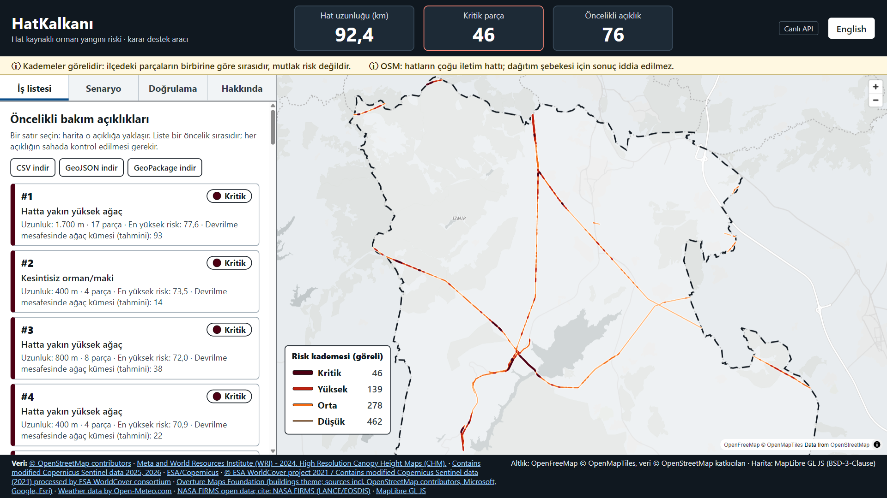
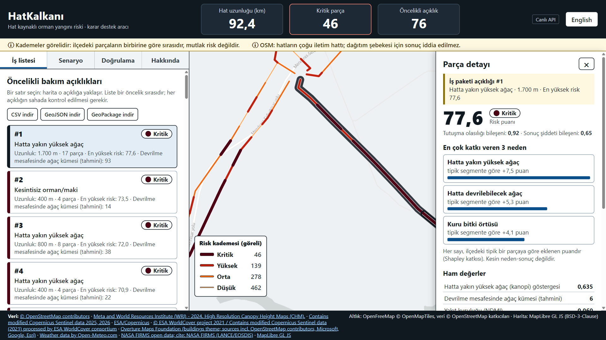
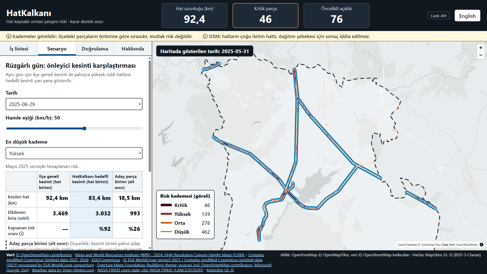
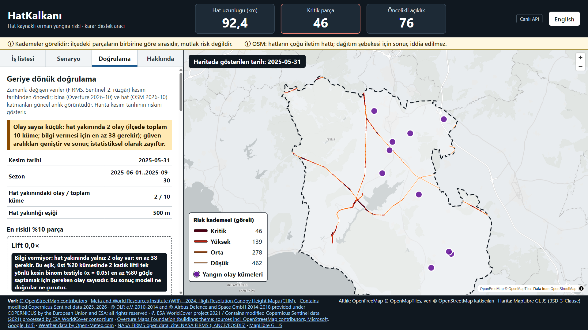
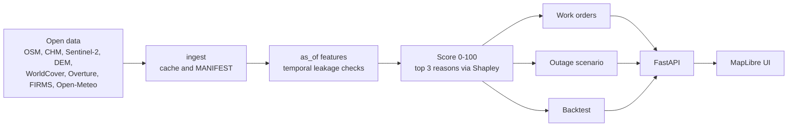

# HatKalkanı

Scores wildfire risk from power lines at the level of 100 m line segments and ranks where a vegetation-trimming crew should go first.

[](https://github.com/muhammeteminayhan/hatkalkani/actions/workflows/ci.yml)
[](LICENSE)
[](pyproject.toml)

**[Live static demo](https://muhammeteminayhan.github.io/hatkalkani/)** · **[Türkçe README](README.md)**



Built for the COP31 Climate Technologies Creathon (October–November 2026).

> The demo is a serverless snapshot of the outputs of 31 October 2026. Live computation runs in a local install.

## Problem

- **Large burned area.** In 2025, Turkey had 3,224 forest fires and 81,473 ha burned. The figures come from news reports citing the General Directorate of Forestry (OGM); OGM's own publication could not be verified.
- **Power lines look larger by area than by count.** According to one expert, power lines account for roughly a quarter of the burned area over the last 10 years. An academic's 2021 calculation gives a 3.2% share of fire count and about a quarter of burned area (37,358 ha / ~140,000 ha). Both are expert statements; no official source was found.
- **Regulation is tighter.** In the EPDK 2026–2030 tariff period, maintenance of facilities in forest areas became annual, pruning and clearing became mandatory, and penalties were set for non-compliance.
- **Preventive outages are broad.** GDZ Elektrik (İzmir) announced preventive mandatory outages in late June 2025 because of strong wind. In Mersin, 2025 precautionary outages also hit the city center.
- **No official finding.** For the 2025 Menderes, Çeşme and Ödemiş fires in İzmir, there are governor's office statements and fire-brigade report claims relayed in the media. No official or judicial finding was made. HatKalkanı does not point to any line as a fire cause.

Sources, correction notes and verification status: [docs/PITCH_FACTS.md](docs/PITCH_FACTS.md) (in Turkish).

## What it does

1. **Corridor risk map.** Gives every 100 m segment a 0–100 priority score and the top 3 reasons that raise it most (Shapley contributions).
2. **Trimming/drone work-order list.** Merges consecutive risky segments into spans and ranks them. Download as CSV, GeoJSON or GeoPackage.
3. **Preventive outage scenario.** On a windy day, compares "the whole district" with "only the risky lines" in line-km and affected buildings (a proxy).

It also runs a **backtest** on the 2025 fire season and reports the result as it is.

| Work list and detail | Scenario | Validation |
|---|---|---|
|  |  |  |

## How it works



- **as_of features:** Every feature is computed for a cut-off date. If data timestamped after the cut-off is used, the tests fail.
- **Score:** A geometric combination of an ignition proxy (P) and a consequence/spread proxy (C): `risk = 100·√(P·C)`. Weights are expert assumptions; this is a rule-based first model with no ML training. Details: [docs/MODEL_CARD.md](docs/MODEL_CARD.md) (in Turkish).
- **Server:** Makes no network calls at runtime; all outputs are precomputed. API contract: [docs/ARCHITECTURE.md](docs/ARCHITECTURE.md).

### Data sources

| Data | Used for | License |
|---|---|---|
| OpenStreetMap (Overpass): overhead lines, district boundary | Line segments | ODbL 1.0 |
| Meta/WRI CHM v2: tree height | Trees near the line and tall enough to strike it | CC BY 4.0 |
| Sentinel-2 L2A | Fuel dryness (NDMI) | Copernicus open data |
| Copernicus DEM GLO-30 | Slope, topographic exposure | Copernicus DEM license |
| ESA WorldCover v200 | Fuel continuity | CC BY 4.0 |
| Overture Maps: buildings | Proximity to settlements, affected buildings | ODbL |
| NASA FIRMS VIIRS | Fire history, backtest events | NASA open data |
| Open-Meteo archive | Wind gusts | CC BY 4.0 |

Attribution texts and links: [docs/ATTRIBUTIONS.md](docs/ATTRIBUTIONS.md).

## Pilot results: İzmir Menderes

Source: outputs in `data/processed/izmir_menderes/`; the file and field behind each line are in [docs/PITCH_FACTS.md](docs/PITCH_FACTS.md) #26–#41.

- **Line network:** 92.4 km of overhead line, 925 segments. 61.0 km is ≥154 kV; for the remaining 31.4 km OSM has no voltage tag.
- **Tiers (relative):** critical 46, high 139, medium 278, low 462 segments.
- **Work orders:** 76 priority spans. The top three:

| Rank | Span | Voltage | Length | Max risk | Main reason |
|---|---|---|---|---|---|
| 1 | 187664557_0001-0017 | 154 kV | 1,700 m | 77.64 | tall tree close to the line |
| 2 | 1181160379_0028-0031 | untagged | 400 m | 73.48 | continuous forest/maquis |
| 3 | 1181160379_0111-0118 | untagged | 800 m | 72.04 | tall tree close to the line |

- **Outage scenario** (29 June 2025, wind threshold 50 km/h, lowest tier high):

| Outage unit | Line | Affected buildings (proxy) | Risk share |
|---|---|---|---|
| Whole district | 92.4 km | 3,469 | - |
| Targeted, OSM line unit | 83.4 km | 3,032 | 91.7% |
| Candidate segment unit (lower bound) | 18.5 km | 993 | 26.0% |

  The targeted outage is almost as large as the whole district because the outage unit is an OSM line and these lines are long transmission lines. The real unit is the distribution company's feeder; without grid topology, 18.5 km is only a lower bound and is not claimed.
- **Backtest** (2025 season): 10 event clusters in the district. Only 2 events fall within 500 m of a line. Neither of these 2 is in the top 10% or top 20% group (hits 0 and 0). **The test is not informative:** the model was neither confirmed nor refuted.

## Honesty and limitations

- **Tiers are relative.** Critical means the top 5% in the district (46 / 925 segments). It is not an absolute hazard level and cannot be compared across districts or dates.
- **Most OSM lines are transmission lines.** The distribution lines that could start line-caused fires are not on the map. No result is claimed for the distribution grid; if a distribution-company line file is supplied (`data/manual/edas/`), it is used.
- **The backtest is not informative.** Only 2 events are near a line; at least 38 are needed (`backtest.json → verdict`). Weights were not tuned on this result. The pilot district and day were chosen with the 2025 fires in mind, so a favorable result would have to be read as optimistic.
- **Tree heights may be outdated.** CHM images date from 2016–2020; growth may be underestimated, and trees trimmed since may still look tall.
- **Static layers postdate as_of.** Buildings (Overture 2026-10-21.0) and lines/boundary (OSM, 2026-10-30) are current snapshots; the 2025-05-31 map uses them too. The effect was not measured and is declared in `backtest.json → leakage`.
- **The output is a priority, not a verdict.** The score is not a fire probability. It does not show that a line caused a fire, a regulatory violation or liability; every work order must be verified on site by eye. Clearance bands in the config are model assumptions, not verified regulation values ([docs/REGULATION_NOTES.md](docs/REGULATION_NOTES.md)).

## Quick start

Requirements: Python 3.12, [uv](https://docs.astral.sh/uv/), a free [NASA FIRMS key](https://firms.modaps.eosdis.nasa.gov/api/map_key/). Disk: `data/` 394 MB + `.venv` 653 MB. Node.js is not needed. Target platforms are Windows and macOS; development was done on Windows 11.

```
uv sync
cp .env.example .env        # Windows: copy .env.example .env; fill in FIRMS_MAP_KEY
uv run python scripts/run_pipeline.py --aoi izmir_menderes --stage all
uv run python scripts/serve.py
uv run pytest
```

Open http://127.0.0.1:8000 in a browser. `.env` is not committed; do not share the key.

- **Stages:** `--stage ingest | features | score | scenario | backtest | all`. `--only <module>` and `--force` apply to ingest only. Server options: `--host`, `--port`, `--aoi`.
- **The first run is long.** Data is downloaded; the first FIRMS download alone took about 25 minutes. Later runs use the cache.
- **Data is not in the repository.** `data/` is git-ignored; the UI shows data after the pipeline has run. The 2 tests that need network access are skipped by default.
- **Opening the static demo locally:** No data or install needed: `python -m http.server 8080 -d web`, then open http://localhost:8080. Do not open it via `file://`; browsers block reading JSON from local files.
- **Static mode:** When the API is unreachable (GitHub Pages, a plain static server), the UI runs on the 31 October 2026 output snapshot in `web/mock/` and says so in the top banner. In this mode the scenario threshold snaps to precomputed values (30–90 km/h in steps of 5). `?mock=1` forces the same mode on the live server; `scripts/make_static_scenarios.py` regenerates the snapshot.
- **Offline:** MapLibre files are in `web/vendor/`. If the online basemap does not load, a plain background, the district boundary and the lines are shown.

## Measured values

| Measure | Value | Source |
|---|---|---|
| Tests | 233 passed, 2 network tests deselected (39 s, clean clone) | [qa-F4-final](docs/reports/qa-F4-final.md) |
| Pipeline, `--stage all` from cache | 140.1 s | [qa-F4](docs/reports/qa-F4.md) |
| UI first load (`window.__hk.ready`) | 526 ms | [qa-F4](docs/reports/qa-F4.md) |

In the clean-clone test the data was copied from the main folder; a from-scratch ingest on a new machine was not tried.

## Project structure

```
src/hatkalkani/   ingest/ features/ model/ api/ export/
scripts/          run_pipeline.py, serve.py
config/           aoi.yaml, risk_weights.yaml, sources.yaml
web/              single-page UI (MapLibre, no build step)
tests/            pytest
docs/             documents, reports, screenshots
data/             raw, interim, processed (git-ignored)
.claude/          sub-agent definitions and skills
```

## Tech stack

Python 3.12 and uv · GeoPandas, Shapely, Rasterio, xarray · pyarrow, DuckDB · FastAPI, Uvicorn · MapLibre GL JS (local copy) · pytest, ruff · GitHub Actions (ruff and pytest).

## AI-assisted development

The project was built with Claude Code in a multi-agent setup. The rules are in [CLAUDE.md](CLAUDE.md) and [.claude/agents/](.claude/agents/) (in Turkish).

- **Roles and model routing:** 10 sub-agents. Search, testing and documentation went to Haiku; data, API and UI code to Sonnet; the risk model and code review to Opus. Each task went to the cheapest agent that could do it.
- **Handoff reports:** Every task ended with a short handoff report; details are under [docs/reports/](docs/reports/).
- **End-of-phase checks:** Each phase ended with a QA round and a separate code review. The review found that the backtest used static layers published after the cut-off date; this is now declared ([review-F3F4](docs/reports/review-F3F4.md)).
- **Leakage tests:** Tests that catch data from after the cut-off are in [tests/features/test_leakage.py](tests/features/test_leakage.py) and [tests/model/test_score_leakage.py](tests/model/test_score_leakage.py).

AI output is a tool; the team is responsible for correctness. Numbers in the texts are tracked with their sources in [docs/PITCH_FACTS.md](docs/PITCH_FACTS.md), and claims found to be wrong were corrected there.

## Documents, license and attributions

| Document | Content |
|---|---|
| [docs/PRD.md](docs/PRD.md) | Product definition and acceptance criteria |
| [docs/ARCHITECTURE.md](docs/ARCHITECTURE.md) | Data flow and API contract |
| [docs/MODEL_CARD.md](docs/MODEL_CARD.md) | Factors, weights, limitations |
| [docs/DECISIONS.md](docs/DECISIONS.md) | Decision records (ADR) |
| [docs/DATA_SOURCES.md](docs/DATA_SOURCES.md) | Data sources, versions, access dates |
| [docs/PITCH_FACTS.md](docs/PITCH_FACTS.md) | Sourced numbers and correction notes |
| [docs/reports/](docs/reports/) | Task, QA and review reports |

The documents under `docs/` are written in Turkish.

**License:** The code is licensed under [MIT](LICENSE). Data outputs are subject to their source licenses; OSM and Overture derivatives fall under ODbL. Licenses and attributions: [docs/ATTRIBUTIONS.md](docs/ATTRIBUTIONS.md).
