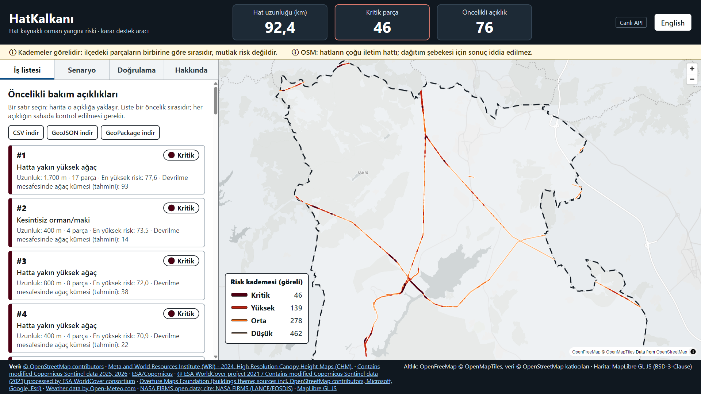
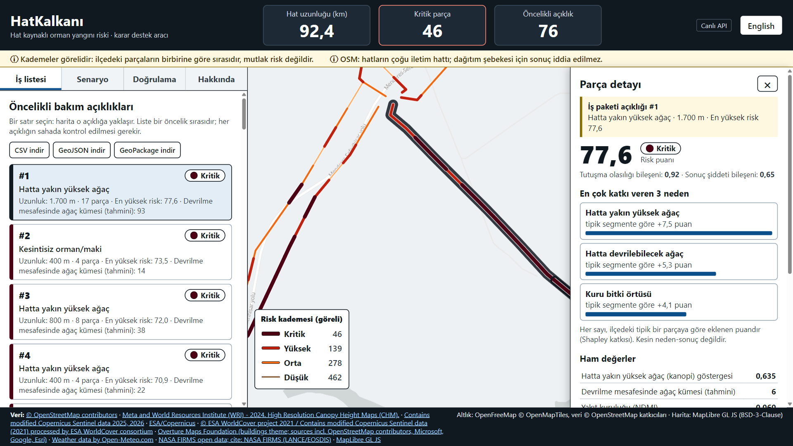
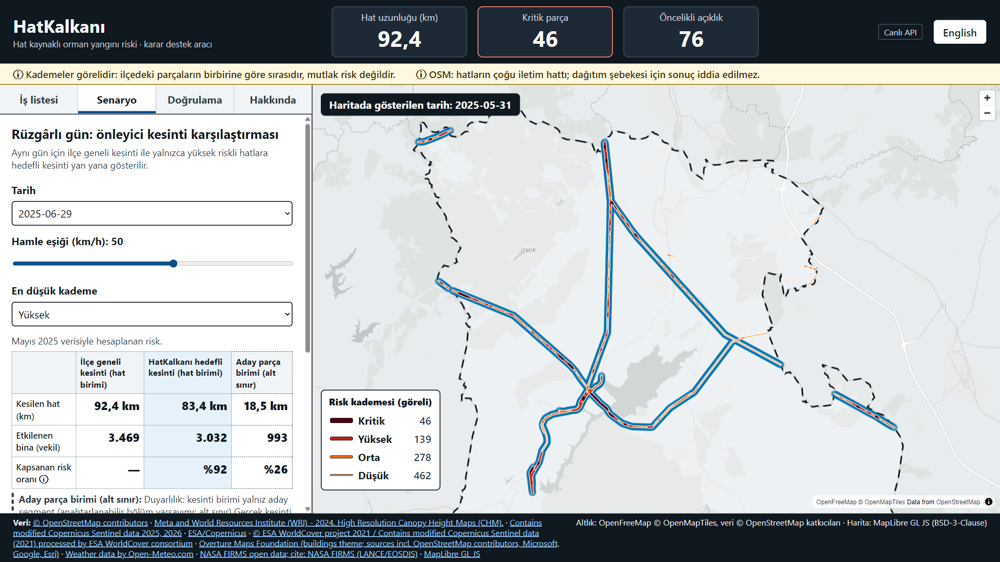
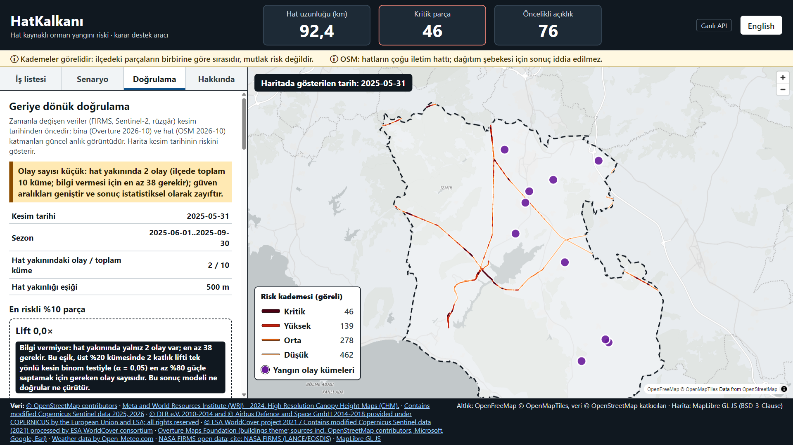
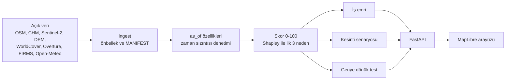

# HatKalkanı

Elektrik hatlarından çıkabilecek orman yangını riskini 100 m'lik hat parçası düzeyinde puanlar ve budama ekibinin önce nereye gideceğini sıralar.

[](https://github.com/muhammeteminayhan/hatkalkani/actions/workflows/ci.yml)
[](LICENSE)
[](pyproject.toml)

**[Canlı statik demo](https://muhammeteminayhan.github.io/hatkalkani/)** · **[English README](README.en.md)**



COP31 İklim Teknolojileri Creathonu için geliştirildi (Ekim–Kasım 2026).

> Demo, 31 Ekim 2026 çıktılarının sunucusuz bir anlık görüntüsüdür. Canlı hesap yerel kurulumda çalışır.

## Problem

- **Yanan alan büyük.** Türkiye'de 2025'te 3.224 orman yangını çıktı ve 81.473 ha alan yandı. Rakamlar OGM verisine atıflı haberlerden alındı; OGM'nin kendi yayını doğrulanamadı.
- **Hatların payı sayıdan çok alanda görünüyor.** Bir uzmana göre elektrik hatları son 10 yılda yanan alanın yaklaşık dörtte birine karşılık geliyor. Bir akademisyenin 2021 hesabında yangın sayısındaki pay %3,2, yanan alandaki pay yaklaşık dörtte bir (37.358 ha / ~140.000 ha). İkisi de uzman ifadesidir; resmî kaynak bulunamadı.
- **Mevzuat sıkılaştı.** EPDK'nın 2026–2030 tarife döneminde ormanlık alandaki tesislerin bakımı yıllık, budama ve temizlik zorunlu oldu; aksatana ceza öngörüldü.
- **Önleyici kesintiler geniş kapsamlı.** GDZ Elektrik (İzmir) Haziran 2025 sonunda kuvvetli rüzgâr nedeniyle önleyici zorunlu kesinti uyguladığını duyurdu. Mersin'de 2025'teki tedbir kesintileri kent merkezini de etkiledi.
- **Resmî tespit yok.** İzmir'de 2025'te Menderes, Çeşme ve Ödemiş yangınları için valilik açıklamaları ve medyada aktarılan itfaiye raporu iddiaları var. Resmî veya yargısal bir tespit yapılmadı. HatKalkanı hiçbir hattı yangın nedeni olarak göstermez.

Kaynaklar, düzeltme notları ve doğrulama durumları: [docs/PITCH_FACTS.md](docs/PITCH_FACTS.md).

## Ne yapar

1. **Koridor risk haritası.** Her 100 m'lik parçaya 0–100 arası bir öncelik skoru ve skoru en çok yükselten ilk 3 neden (Shapley katkısı) verir.
2. **Budama/drone iş emri listesi.** Ardışık riskli parçaları açıklıklara birleştirip sıralar. CSV, GeoJSON ve GeoPackage olarak indirilir.
3. **Önleyici kesinti senaryosu.** Rüzgârlı bir günde "ilçenin tamamı" ile "yalnızca riskli hatlar" seçeneğini hat-km ve etkilenen bina (vekil) olarak karşılaştırır.

Ayrıca 2025 yangın sezonu üzerinde **geriye dönük test** yapar ve sonucu olduğu gibi raporlar.

| İş listesi ve detay | Senaryo | Doğrulama |
|---|---|---|
|  |  |  |

## Nasıl çalışır



- **as_of özellikleri:** Her özellik bir kesit tarihine göre hesaplanır. Kesitten sonraki zaman damgalı veri kullanılırsa test hata verir.
- **Skor:** Tutuşma vekili (P) ile sonuç/yayılım vekilinin (C) geometrik birleşimi: `risk = 100·√(P·C)`. Ağırlıklar uzman varsayımıdır; kural tabanlı ilk modeldir, ML eğitimi yoktur. Ayrıntı: [docs/MODEL_CARD.md](docs/MODEL_CARD.md).
- **Sunucu:** Çalışırken ağ çağrısı yapmaz; tüm çıktılar önceden hesaplanır. API sözleşmesi: [docs/ARCHITECTURE.md](docs/ARCHITECTURE.md).

### Veri kaynakları

| Veri | Ne için | Lisans |
|---|---|---|
| OpenStreetMap (Overpass): havai hatlar, ilçe sınırı | Hat parçaları | ODbL 1.0 |
| Meta/WRI CHM v2: ağaç yüksekliği | Hatta yakın ve devrilebilir ağaç | CC BY 4.0 |
| Sentinel-2 L2A | Kuruluk (NDMI) | Copernicus açık veri |
| Copernicus DEM GLO-30 | Eğim, topoğrafik açıklık | Copernicus DEM lisansı |
| ESA WorldCover v200 | Yakıt sürekliliği | CC BY 4.0 |
| Overture Maps: binalar | Yerleşime yakınlık, etkilenen bina | ODbL |
| NASA FIRMS VIIRS | Yangın geçmişi, test olayları | NASA açık veri |
| Open-Meteo arşivi | Rüzgâr hamlesi | CC BY 4.0 |

Atıf metinleri ve bağlantılar: [docs/ATTRIBUTIONS.md](docs/ATTRIBUTIONS.md).

## Pilot sonuçları: İzmir Menderes

Kaynak: `data/processed/izmir_menderes/` çıktıları; her satırın dosya ve alanı [docs/PITCH_FACTS.md](docs/PITCH_FACTS.md) #26–#41'de.

- **Hat ağı:** 92,4 km havai hat, 925 parça. 61,0 km'si ≥154 kV; kalan 31,4 km'de OSM'de gerilim etiketi yok.
- **Kademeler (göreli):** kritik 46, yüksek 139, orta 278, düşük 462 parça.
- **İş emri:** 76 öncelikli açıklık. İlk üçü:

| Sıra | Açıklık | Gerilim | Uzunluk | En yüksek risk | Ana neden |
|---|---|---|---|---|---|
| 1 | 187664557_0001-0017 | 154 kV | 1.700 m | 77,64 | hatta yakın yüksek ağaç |
| 2 | 1181160379_0028-0031 | etiketsiz | 400 m | 73,48 | kesintisiz orman/maki |
| 3 | 1181160379_0111-0118 | etiketsiz | 800 m | 72,04 | hatta yakın yüksek ağaç |

- **Kesinti senaryosu** (29.06.2025, rüzgâr eşiği 50 km/sa, en düşük kademe yüksek):

| Kesinti birimi | Hat | Etkilenen bina (vekil) | Risk payı |
|---|---|---|---|
| İlçe geneli | 92,4 km | 3.469 | - |
| Hedefli, OSM hattı birimi | 83,4 km | 3.032 | %91,7 |
| Aday parça birimi (alt sınır) | 18,5 km | 993 | %26,0 |

  Hedefli kesinti neredeyse ilçe geneline eşit, çünkü kesinti birimi OSM hattıdır ve hatlar uzun iletim hatlarıdır. Gerçek birim EDAŞ fideridir; şebeke topolojisi olmadan 18,5 km iddia edilmez, yalnızca alt sınırdır.
- **Geriye dönük test** (2025 sezonu): ilçede 10 olay kümesi var. Hatta 500 m içinde yalnızca 2 olay düşüyor. Bu 2 olay üst %10'luk ve üst %20'lik kümelerde değil (isabet 0 ve 0). **Test bilgi vermiyor:** model ne doğrulandı ne çürütüldü.

## Dürüstlük ve sınırlılıklar

- **Kademeler görelidir.** Kritik, ilçedeki en yüksek %5 demektir (46 / 925 parça). Mutlak tehlike düzeyi değildir; ilçeler veya tarihler arasında karşılaştırılamaz.
- **OSM hatlarının çoğu iletim hattıdır.** Hat kaynaklı yangınların çıkabileceği dağıtım hatları haritada yok. Dağıtım şebekesi için sonuç iddia edilmez; EDAŞ hat dosyası gelirse (`data/manual/edas/`) o kullanılır.
- **Geriye dönük test bilgi vermiyor.** Hatta yakın yalnızca 2 olay var; testin bilgi vermesi için en az 38 gerekir (`backtest.json → verdict`). Ağırlıklar bu sonuca bakılarak ayarlanmadı. Pilot ilçe ve gün, 2025 yangınları bilinerek seçildi; olumlu bir sonuç iyimser okunmalıdır.
- **Ağaç yüksekliği eski olabilir.** CHM görüntüleri 2016–2020 tarihli; büyüme eksik tahmin edilebilir, budanan ağaçlar hâlâ yüksek görünebilir.
- **Statik katmanlar as_of sonrasına ait.** Bina (Overture 2026-10-21.0) ve hat/sınır (OSM, 2026-10-30) güncel anlık görüntüdür; 2025-05-31 haritası da bunları kullanır. Etkisi ölçülmedi ve `backtest.json → leakage` alanında beyan edilir.
- **Çıktı bir önceliktir, kesin hüküm değil.** Skor yangın olasılığı değildir. Bir hattın yangına yol açtığını, yönetmelik ihlalini veya sorumluluğu göstermez; her iş emri sahada gözle doğrulanmalıdır. Config'teki açıklık bantları model varsayımıdır, doğrulanmış yönetmelik değeri değildir ([docs/REGULATION_NOTES.md](docs/REGULATION_NOTES.md)).

## Hızlı başlangıç

Gereksinimler: Python 3.12, [uv](https://docs.astral.sh/uv/), ücretsiz bir [NASA FIRMS anahtarı](https://firms.modaps.eosdis.nasa.gov/api/map_key/). Disk: `data/` 394 MB + `.venv` 653 MB. Node.js gerekmez. Hedef platform Windows ve macOS; geliştirme Windows 11'de yapıldı.

```
uv sync
cp .env.example .env        # Windows: copy .env.example .env; FIRMS_MAP_KEY değerini doldurun
uv run python scripts/run_pipeline.py --aoi izmir_menderes --stage all
uv run python scripts/serve.py
uv run pytest
```

Tarayıcıda http://127.0.0.1:8000 açın. `.env` git'e girmez; anahtarı paylaşmayın.

- **Aşamalar:** `--stage ingest | features | score | scenario | backtest | all`. `--only <modül>` ve `--force` yalnız ingest içindir. Sunucu seçenekleri: `--host`, `--port`, `--aoi`.
- **İlk çalıştırma uzundur.** Veri indirilir; yalnızca FIRMS'in ilk indirmesi yaklaşık 25 dakika sürdü. Sonraki çalıştırmalar önbellekten gelir.
- **Veri depoda yok.** `data/` git dışıdır; arayüz, pipeline çalıştıktan sonra veri gösterir. Ağ gerektiren 2 test varsayılan çalıştırmada atlanır.
- **Statik demoyu yerelde açmak:** Veri ve kurulum gerekmez: `python -m http.server 8080 -d web`, ardından http://localhost:8080. `file://` ile açmayın; tarayıcı yerel dosyadan JSON okumayı engeller.
- **Statik mod:** API'ye ulaşılamazsa (GitHub Pages, düz statik sunucu) arayüz `web/mock/` altındaki 31 Ekim 2026 çıktı anlık görüntüsüyle çalışır ve bunu üst bantta belirtir. Bu modda senaryo eşiği önceden hesaplanmış değerlere (30–90 km/sa, 5'er) oturur. `?mock=1` aynı modu canlı sunucuda da açar; anlık görüntüyü `scripts/make_static_scenarios.py` üretir.
- **Çevrimdışı:** MapLibre dosyaları `web/vendor/` altındadır. Çevrimiçi altlık gelmezse düz zemin, ilçe sınırı ve hatlar gösterilir.

## Ölçülen değerler

| Ölçü | Değer | Kaynak |
|---|---|---|
| Test | 233 geçti, 2 ağ testi seçilmedi (39 sn, temiz klon) | [qa-F4-final](docs/reports/qa-F4-final.md) |
| Pipeline, önbellekten `--stage all` | 140,1 sn | [qa-F4](docs/reports/qa-F4.md) |
| Arayüz ilk açılış (`window.__hk.ready`) | 526 ms | [qa-F4](docs/reports/qa-F4.md) |

Temiz klon testinde veri ana klasörden kopyalandı; sıfırdan ingest yeni bir makinede denenmedi.

## Proje yapısı

```
src/hatkalkani/   ingest/ features/ model/ api/ export/
scripts/          run_pipeline.py, serve.py
config/           aoi.yaml, risk_weights.yaml, sources.yaml
web/              tek sayfa arayüz (MapLibre, derleme adımı yok)
tests/            pytest
docs/             belgeler, raporlar, ekran görüntüleri
data/             raw, interim, processed (git dışı)
.claude/          alt ajan tanımları ve skill'ler
```

## Teknoloji yığını

Python 3.12 ve uv · GeoPandas, Shapely, Rasterio, xarray · pyarrow, DuckDB · FastAPI, Uvicorn · MapLibre GL JS (yerel kopya) · pytest, ruff · GitHub Actions (ruff ve pytest).

## Yapay zekâ destekli geliştirme

Proje Claude Code ile çok ajanlı bir düzende geliştirildi. Kurallar [CLAUDE.md](CLAUDE.md) ve [.claude/agents/](.claude/agents/) altındadır.

- **Rol ve model yönlendirmesi:** 10 alt ajan. Arama, test ve belge işleri Haiku'ya; veri, API ve arayüz kodu Sonnet'e; risk modeli ve kod incelemesi Opus'a verildi. Her iş yapabilecek en ucuz ajana gitti.
- **Handoff raporları:** Her görev kısa bir teslim raporuyla bitti; ayrıntılar [docs/reports/](docs/reports/) altında.
- **Faz sonu denetimi:** Her faz sonunda QA turu ve ayrı bir kod incelemesi yapıldı. İnceleme, geriye dönük testin kesitten sonra yayımlanmış statik katmanlar kullandığını buldu; bu beyan edildi ([review-F3F4](docs/reports/review-F3F4.md)).
- **Sızıntı testleri:** Kesitten sonraki veriyi yakalayan testler [tests/features/test_leakage.py](tests/features/test_leakage.py) ve [tests/model/test_score_leakage.py](tests/model/test_score_leakage.py) içindedir.

Yapay zekâ çıktısı araçtır; doğruluktan ekip sorumludur. Metinlerdeki sayılar kaynaklarıyla [docs/PITCH_FACTS.md](docs/PITCH_FACTS.md) içinde izlenir ve hatalı bulunan iddialar orada düzeltildi.

## Belgeler, lisans ve atıflar

| Belge | İçerik |
|---|---|
| [docs/PRD.md](docs/PRD.md) | Ürün tanımı ve kabul kriterleri |
| [docs/ARCHITECTURE.md](docs/ARCHITECTURE.md) | Veri akışı ve API sözleşmesi |
| [docs/MODEL_CARD.md](docs/MODEL_CARD.md) | Faktörler, ağırlıklar, sınırlılıklar |
| [docs/DECISIONS.md](docs/DECISIONS.md) | Karar kayıtları (ADR) |
| [docs/DATA_SOURCES.md](docs/DATA_SOURCES.md) | Veri kaynakları, sürümler, erişim tarihleri |
| [docs/PITCH_FACTS.md](docs/PITCH_FACTS.md) | Kaynaklı sayılar ve düzeltme notları |
| [docs/reports/](docs/reports/) | Görev, QA ve inceleme raporları |

**Lisans:** Kod [MIT](LICENSE) lisanslıdır. Veri çıktıları kaynaklarının lisanslarına tabidir; OSM ve Overture türevleri ODbL kapsamındadır. Lisanslar ve atıflar: [docs/ATTRIBUTIONS.md](docs/ATTRIBUTIONS.md).
